# 企业AI教程Creative Cloud

探索可帮助您使用Creative Cloud中的AI发现创意、创建内容和简化创意工作流程的教程。 这些教程按角色分组：图形Designer、Creative/Art Director、Photoshop艺术家/Retoucher和视频编辑器。

## 图形Designer

<table style="table-layout:fixed">
<tr>
 <td>
   <a href="turn-flat-vector-art.md">
      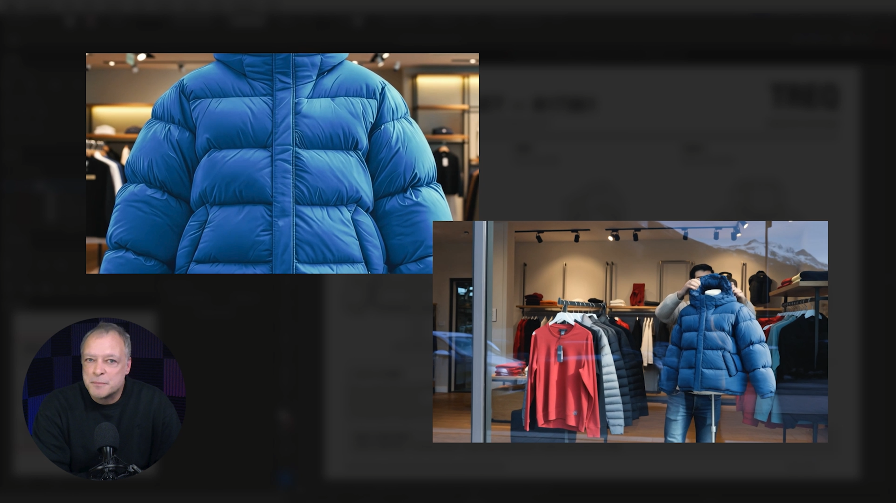
   </a>
    

   <a href="turn-flat-vector-art.md"><strong>将平面矢量图转换为任意角度 — 无需重新绘制</strong></a>
    

    <em>了解如何在Illustrator中使用文本设置图案</em>
     
  </td>
  <td>
   <a href="seamless-vector.md">
      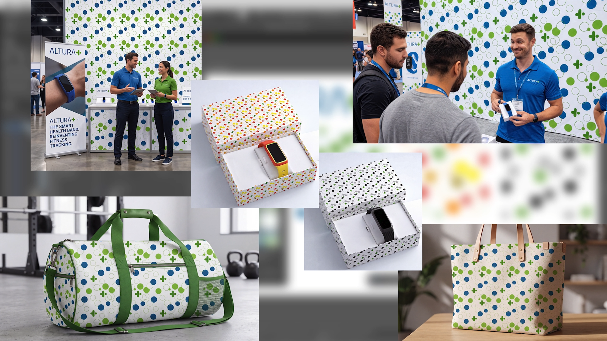
   </a>
    

   <a href="seamless-vector.md"><strong>几分钟内即可形成无缝的矢量图案，而不是几小时</strong></a>
    

    <em>了解如何在Illustrator中构建无缝品牌图案，而无需手动检查每个重复边缘</em>
     
  </td>
  <td>
   <a href="sketch-to-clean.md">
      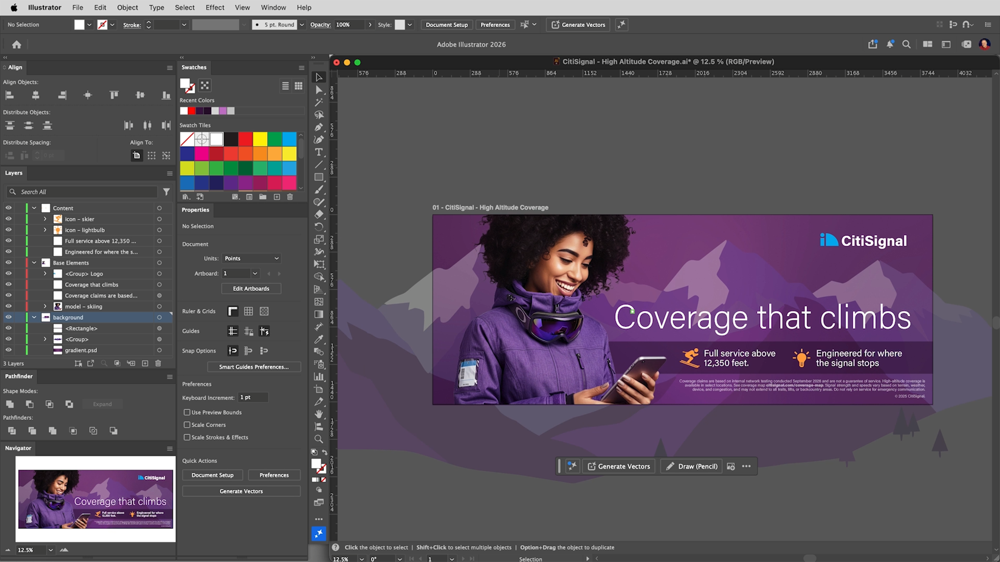
   </a>
    

   <a href="sketch-to-clean.md"><strong>从草图到干净的可编辑矢量</strong></a>
    

    <em>了解如何在Illustrator中将粗略的草图转换为可编辑的矢量图</em>
     
  </td>
  <td>
   <a href="vector-to-layout.md">
      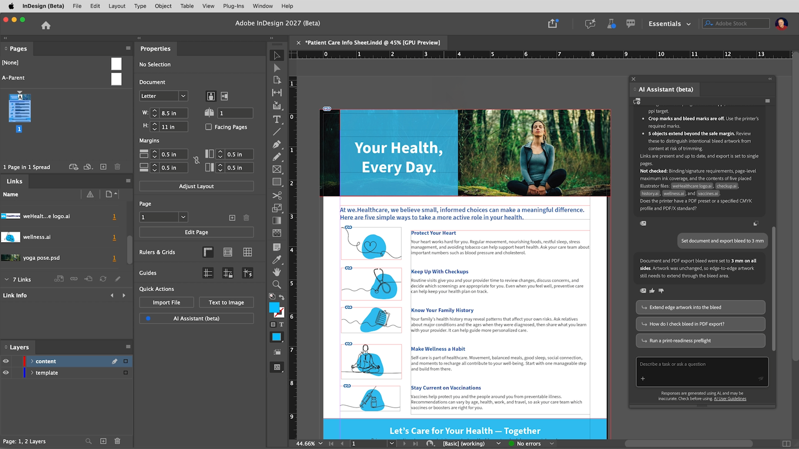
   </a>
    

   <a href="vector-to-layout.md"><strong>将矢量图移入InDesign布局中并将其打包以便交接</strong></a>
    

    <em>通过询问InDesign中的AI Assistant了解如何检查打印布局</em>
     
  </td>
</tr>
</table>

## Creative/Art Director

<table style="table-layout:fixed">
<tr>
  <td>
   <a href="one-brief.md">
      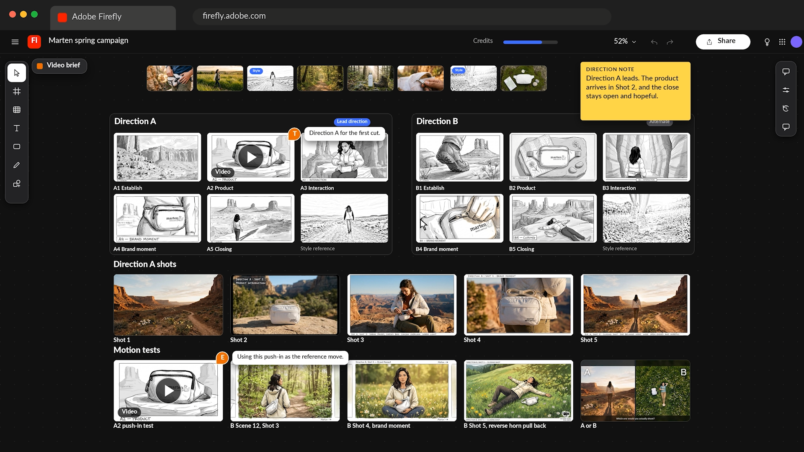
   </a>
    

   <a href="one-brief.md"><strong>午饭前，从一份简报获得20条路线</strong></a>
    

    <em>了解如何将创意简报转变为具有强烈视觉指导的共享讨论区</em>
     
  </td>
  <td>
   <a href="brief-to-storyboard.md">
      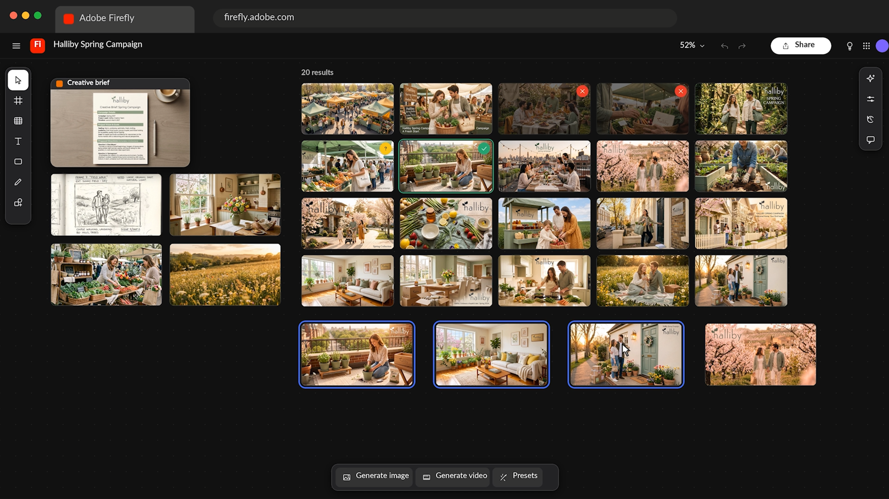
   </a>
    

   <a href="brief-to-storyboard.md"><strong>从简报到情节提要：在生产之前探索视频方向</strong></a>
    

    <em>了解如何将创意简报转变为具有强烈视觉指导的共享讨论区</em>
     
  </td>
  <td>
    
    

     
  </td>
  <td>
    
    

     
  </td>
</tr>
</table>

## Photoshop Artist/Retoucher

<table style="table-layout:fixed">
<tr>
  <td>
   <a href="retouch-faster.md">
      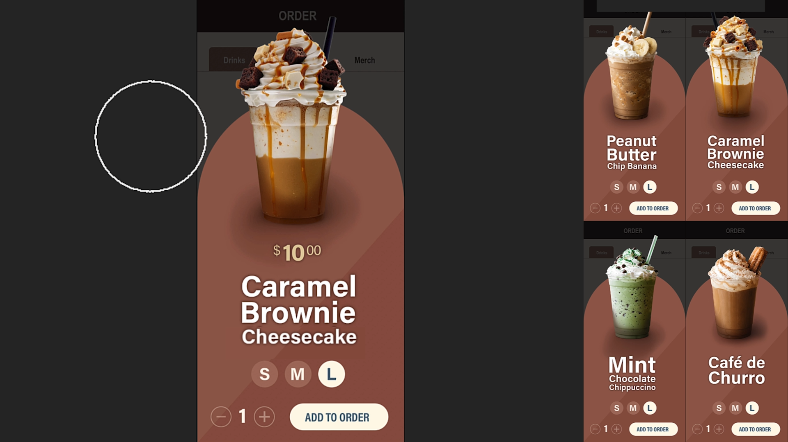
   </a>
    

   <a href="retouch-faster.md"><strong>更快地修饰并保持原始像素</strong></a>
    

    <em>了解如何在Photoshop中为产品照片添加自然阴影，同时保持原始像素不变</em>
     
  </td>
  <td>
   <a href="build-presets.md">
      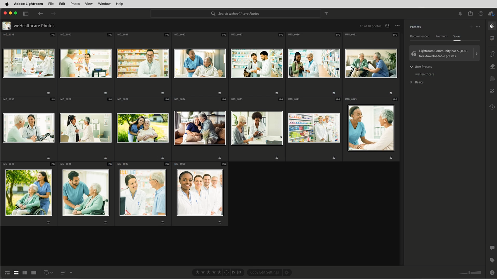
   </a>
    

   <a href="build-presets.md"><strong>构建预设，使整个拍摄的颜色保持一致</strong></a>
    

    <em>了解如何在不逐张编辑每个图像的情况下，使整个照片看起来保持一致</em>
     
  </td>
  <td>
   <a href="adapt.md">
      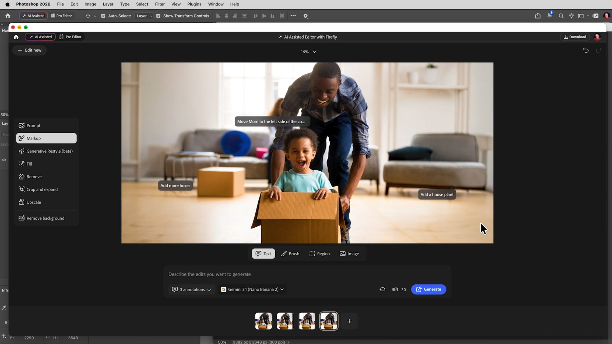
   </a>
    

   <a href="adapt.md"><strong>使用生成工具清理和调整图像</strong></a>
    

    <em>了解如何使用Generative Expand和Generative Fill Extend来强化您的创意</em>
     
  </td>
  <td>
    
    

     
  </td>
</tr>
</table>

## 视频编辑器

<table style="table-layout:fixed">
<tr>
  <td>
   <a href="fill-gaps.md">
      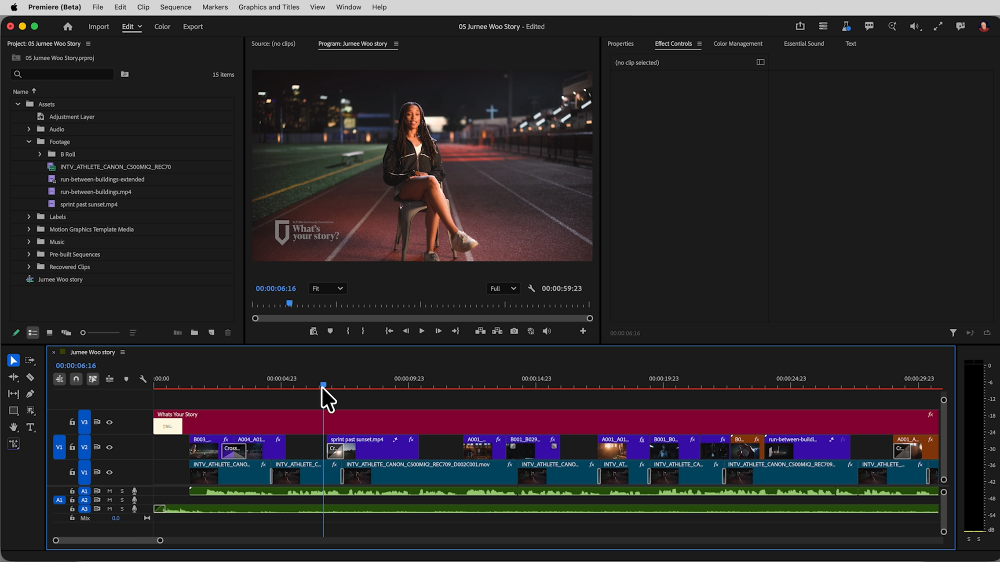
   </a>
    

   <a href="fill-gaps.md"><strong>填充剪切中的空隙：B形、音频和即将结束的剪辑</strong></a>
    

    <em>了解如何在Premiere中使用生成式扩展</em>
     
  </td>
 <td>
   <a href="rough-cut.md">
      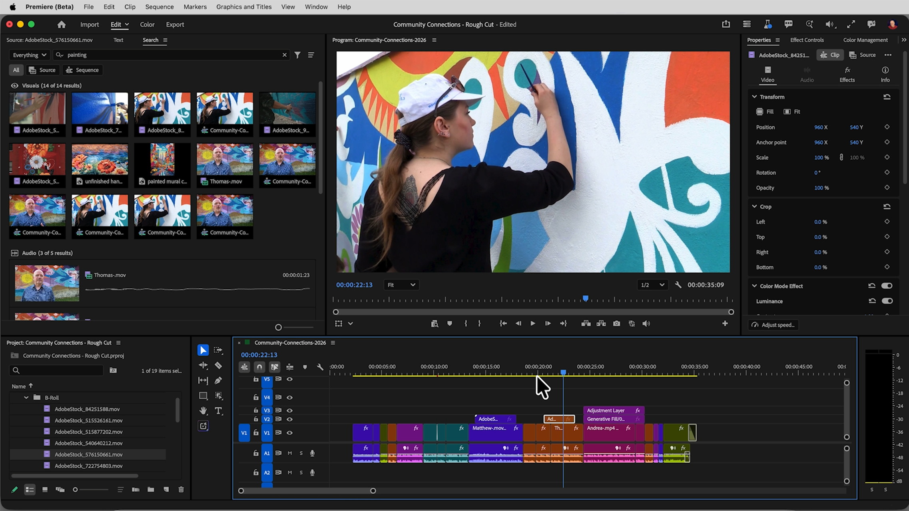
   </a>
    

   <a href="rough-cut.md"><strong>更快地获得粗剪</strong></a>
    

    <em>了解如何在Premiere中更快地从访谈和B形滚动中构建粗剪，而无需划动每个剪辑</em>
     
  </td>
  <td>
   <a href="match-color.md">
      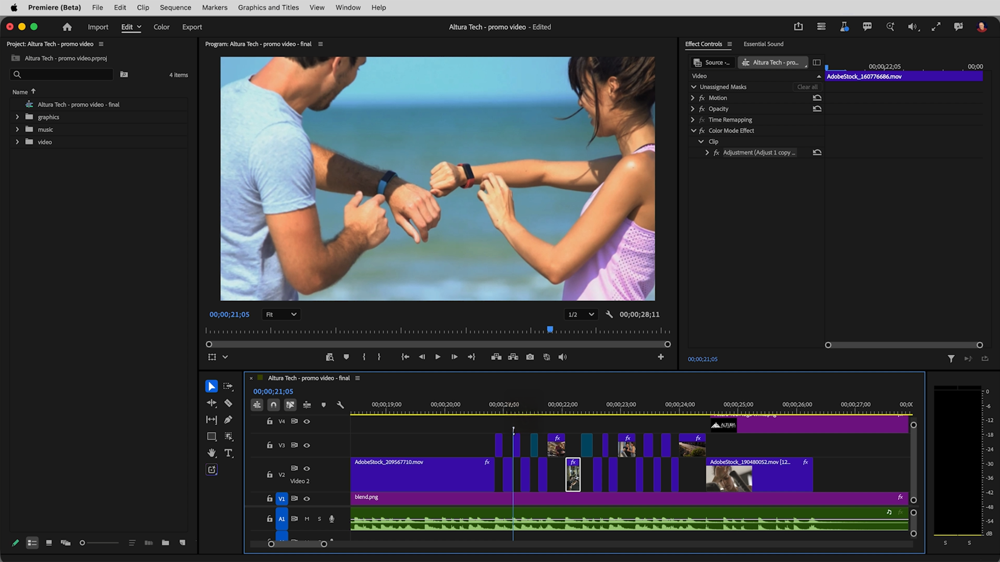
   </a>
    

   <a href="match-color.md"><strong>镜头间颜色匹配 — 无需色轮</strong></a>
    

    <em>了解如何使镜头以不同的方式照亮，看起来像是属于同一编辑区域</em>
     
  </td>
 <td>
   <a href="pull-noise.md">
      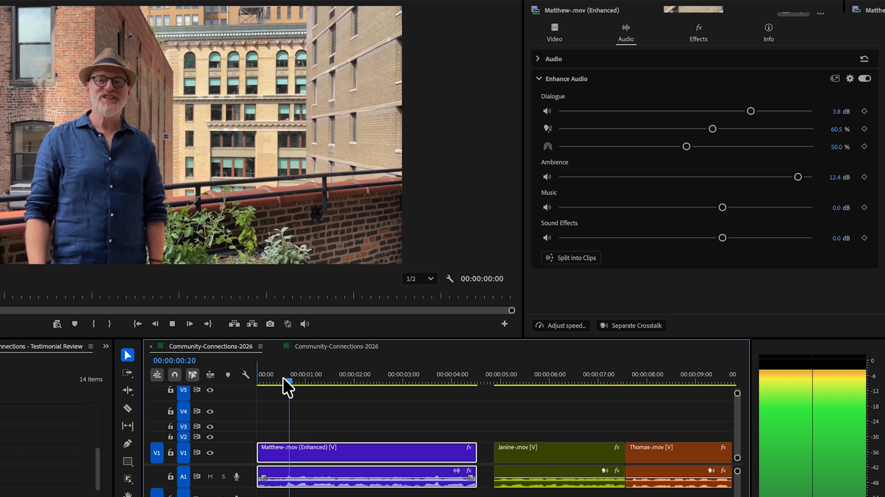
   </a>
    

   <a href="pull-noise.md"><strong>Adobe Premiere的新增功能：分开“拉取”对话框、环境和噪声</strong></a>
    

    <em>了解如何通过拆分音频来修复对话</em>
     
  </td>
</tr>
</table>

